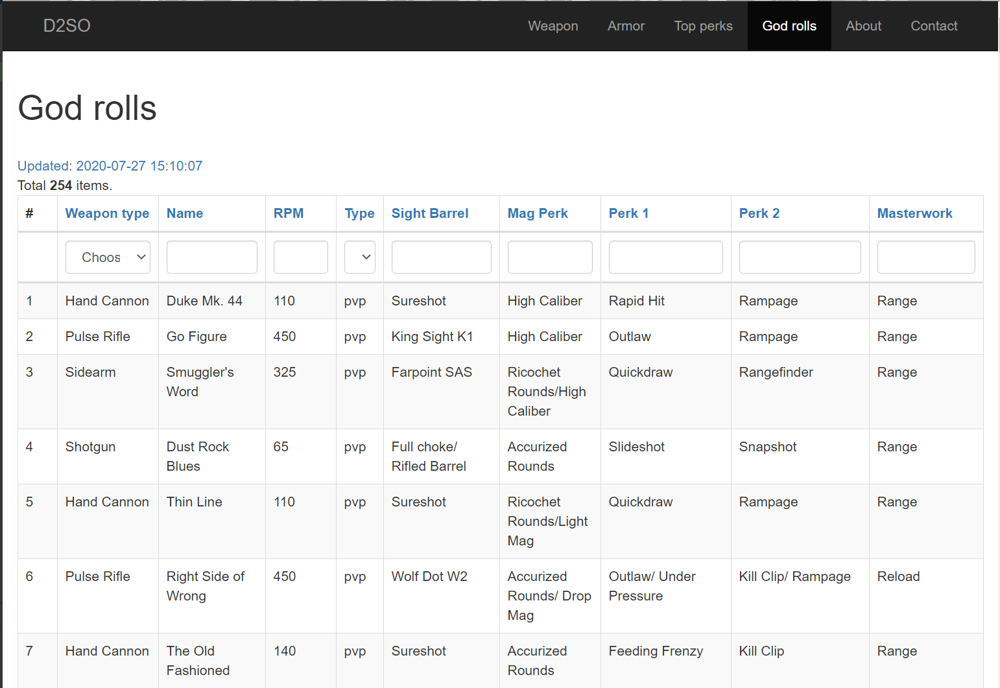
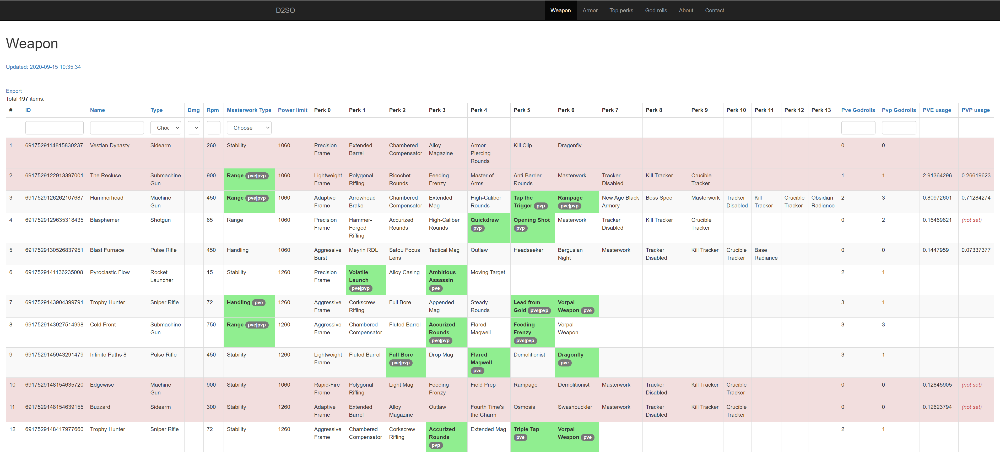
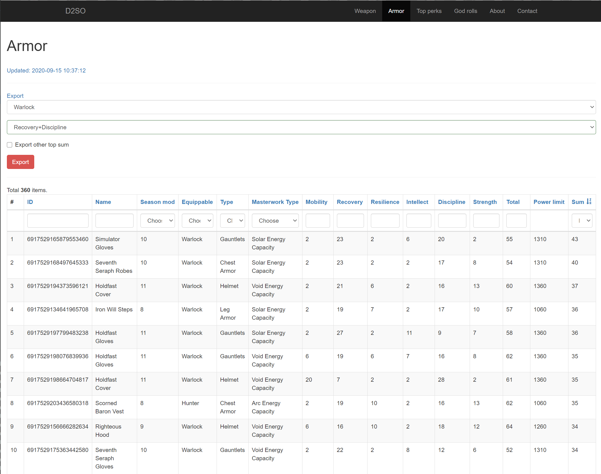

<h1 align="center">Destiny 2 Storage Optimization</h1>

<p align="center">
  <b>Web application that helps Destiny 2 players decide which items to keep in their storage.</b><br/>
  Built on the <a href="https://www.yiiframework.com/">Yii 2</a> framework.
</p>

<p align="center">
  <a href="#license"></a>
  
  
  
</p>

> ⚠️ **Discontinued.** This project is no longer maintained. It is published as-is for
> portfolio purposes only — see the [Disclaimer](#disclaimer) below.

---

In Destiny 2 the vault (storage) is limited, and most players end up hoarding weapons and armor
"just in case". This app automates the decision of what to keep:

- it authenticates you via the official **Bungie OAuth**,
- imports your items from **[DIM](https://destinyitemmanager.com/) (Destiny Item Manager)** CSV exports,
- analyzes them against curated god roll lists and live weapon usage stats,
- exports ready-to-use **DIM tags** so you can filter and clean your vault in one click.

> **Note.** The app was originally built around the Bungie API, but that direction was abandoned
> in favor of a simpler and more practical integration with DIM exports/tags.

---

## Features

### OAuth via Bungie

Sign in with your Bungie.net account through a custom OAuth2 client (`app\components\Bungie`,
built on `yii\authclient\OAuth2`). The Bungie membership ID is used as the application identity.

### Weapon godroll highlighter

Was implemented before wishlists appeared in DIM — nowadays it is mostly a historical feature,
but it remains a good example of CSV/XLSX import pipelines and third-party API integration.

- **Import god rolls** from the Excel file [`docs/God Roll Weapons.xlsx`](docs/God%20Roll%20Weapons.xlsx).
  On import the application fetches weapon type and RPM from the
  [destinytracker.com](https://destinytracker.com/) API.
  
- **Import weapons** from a DIM CSV export (`docs/destinyWeapons.csv`).
  
  Green cell — a godroll, red row — a weapon that is not in the god rolls list.
  When importing, the application:
  - fetches PVP and PVE usage from the destinytracker.com API;
  - counts PVP/PVE god rolls for each weapon against the imported god rolls list and highlights them;
  - if a weapon is missing from the list, its god rolls are derived from weapon type and RPM.
- **Export tags** back to DIM in CSV format, with the number of god rolls per weapon.

### Armor stats maximizer

- **Import armors** from a DIM CSV export (`docs/destinyArmor.csv`).
  
  During import the application precomputes the sum of every possible pair of attributes:
  - Mobility, Recovery, Resilience, Intellect, Discipline, Strength
- **Export tags** for DIM: the user picks a class and a pair of attributes, and the app exports
  a `keep` tag for:
  - the 3 best armors of each type by the chosen pair of attributes;
  - optionally ("Export other top sum") 2 armors of the current season of each type with the
    best remaining pairs;
  - all armors of the current and previous season whose total stat sum is `> 57`;
  - all armors whose total stat sum is `> 60`.

## Tech stack

| Layer      | Technology |
|------------|------------|
| Language   | PHP 7.1 |
| Framework  | Yii 2 (basic project template, ~2.0.14) |
| UI         | Bootstrap (yii2-bootstrap) |
| Database   | MySQL (schema in [`dump.sql`](dump.sql)) |
| Auth       | OAuth2 via Bungie.net (`yiisoft/yii2-authclient`, custom client) |
| Documents  | Excel/CSV import-export (`phpoffice/phpspreadsheet`) |
| Config     | `.env` files (`vlucas/phpdotenv`) |
| Tests      | Codeception (unit / functional / acceptance) |
| Dev env    | Docker (`yiisoftware/yii2-php:7.1-apache`) and Vagrant |

### Project structure at a glance

- `components/Bungie.php` — custom OAuth2 auth client for Bungie.net
- `controllers/SiteController.php` — all app flows: sync/export of weapons, armor, god rolls
- `models/` — ActiveRecord models (`Weapons`, `Armors`, `Godroll`, `Usage`, ...) and forms
- `docs/` — sample DIM CSV exports and the god rolls Excel file
- `dump.sql` — MySQL database schema

## Getting started

### Requirements

- PHP >= 7.1 with extensions required by Yii 2 (see [requirements.php](requirements.php))
- [Composer](https://getcomposer.org/)
- MySQL 5.7+
- A [Bungie API key](https://www.bungie.net/en/Application) (OAuth client ID)

### Installation

```bash
# 1. Clone the repository
git clone https://github.com/Sc0rri/d2so.git
cd d2so

# 2. Install PHP dependencies
composer install

# 3. Create your local configuration
cp .env.dist .env
```

Fill in `.env` with your settings:

```ini
APP_ENV = 'dev'
DB_HOST = 'localhost'
DB_NAME = 'd2so'
DB_USER = 'root'
DB_PASSWORD = 'secret'
BUNGIE_CLIENT_ID = 'your-bungie-client-id'
```

```bash
# 4. Create the database and import the schema
mysql -u root -p -e "CREATE DATABASE d2so CHARACTER SET utf8"
mysql -u root -p d2so < dump.sql

# 5. Run the app with Docker (http://localhost:8000) ...
docker-compose up

# ... or with Vagrant (see vagrant/config/vagrant-local.example.yml)
vagrant up
```

Log in with your Bungie account, then use the *Sync* pages to import god rolls, weapons
and armor from the CSV/XLSX files in [`docs/`](docs/), and the *Export* pages to generate
DIM tag files.

## Testing

The project ships with Codeception suites (unit, functional, acceptance):

```bash
vendor/bin/codecept build
vendor/bin/codecept run
```

## Disclaimer

**This project is discontinued.** It was developed in 2021 and is no longer maintained.
It is kept as-is as a showcase of the original implementation:

- DIM introduced native wishlists, which made the godroll highlighter largely redundant.
- The destinytracker.com API and Bungie API have changed since 2021, so parts of the integration
  may need updates to work against the current endpoints.
- The armor stats maximizer is based on season-era stat rules of that time.

## License

Released under the [BSD 3-Clause License](LICENSE). Copyright (c) 2021, Alex Puschev.
